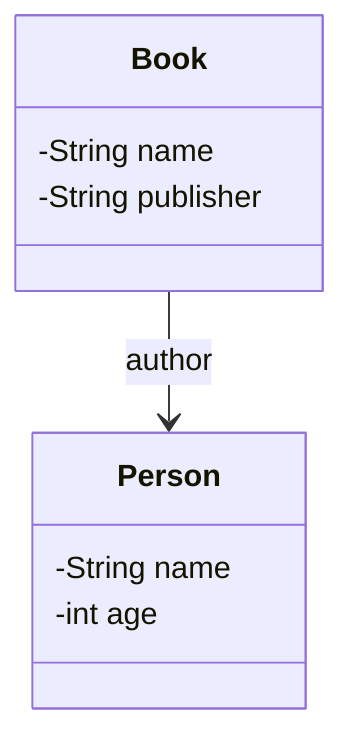
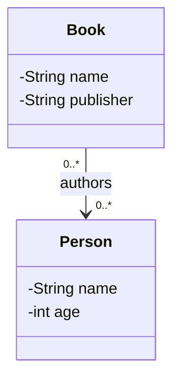
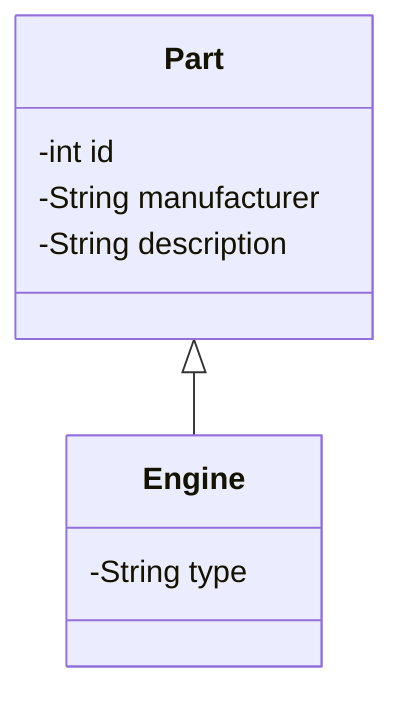
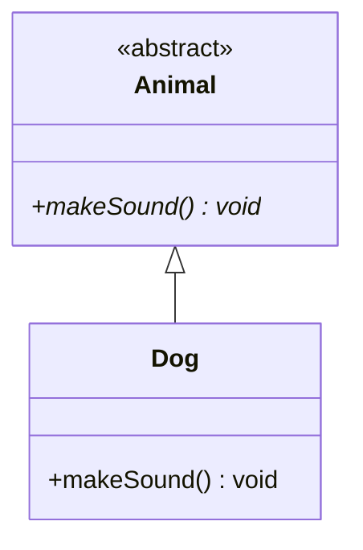
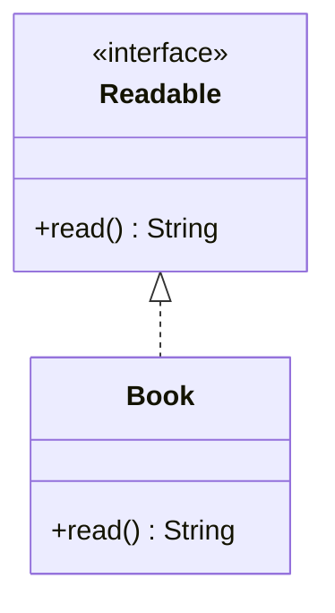
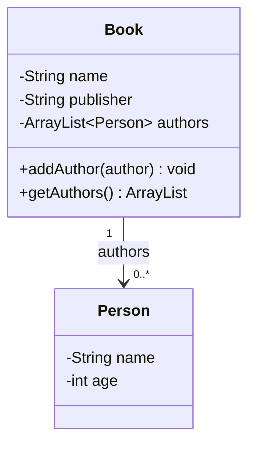

# Dispensa di Informatica: i Class Diagram (UML)
---
Studente: Filippo Pilati

Classe: Quarta – Indirizzo Informatica

Istituto: I.T.T. Guglielmo Marconi, Rovereto

Materia: Informatica

---
### **Indice**

1. Introduzione ai Class Diagram
1. Come si rappresenta una classe
1. Attributi, costruttori e metodi
1. Cosa mostra un Class Diagram
1. Le relazioni tra le classi
1. Ereditarietà e classi astratte
1. Le interfacce
1. Come progettare un Class Diagram
1. Dal diagramma al codice Java
1. Riepilogo e autoverifica

### **Fonti**
**1. Introduzione ai Class Diagram:**

Quando si sviluppa un programma, soprattutto se è composto da molte classi, può diventare difficile capire come sono organizzate tutte le sue parti. Prima di iniziare a scrivere il codice, quindi, può essere utile realizzare uno schema che permetta di avere una visione generale della struttura del software.


A questo scopo si utilizzano i Class Diagram, chiamati in italiano diagrammi delle classi. Si tratta di rappresentazioni grafiche che mostrano le classi di un programma, le loro caratteristiche e le relazioni che esistono tra di esse.

I Class Diagram fanno parte di UML, acronimo di Unified Modeling Language, cioè un linguaggio di modellazione unificato. UML mette a disposizione simboli e regole condivisi, in modo che persone diverse possano leggere e comprendere lo stesso diagramma senza dover interpretare ogni volta una notazione differente.

Questi diagrammi sono particolarmente utili nella programmazione a oggetti, perché permettono di ragionare sulla struttura di un software prima di realizzarlo in un linguaggio come Java.

- A cosa servono?
Un Class Diagram permette di:

individuare le classi che compongono un programma;
descrivere gli attributi, i costruttori e i metodi di ogni classe;
capire come le classi sono collegate tra loro;
rappresentare l'ereditarietà e l'implementazione delle interfacce;
facilitare la progettazione, la manutenzione e la comprensione del codice.
Per esempio, in un programma per gestire una biblioteca potrebbero esserci le classi Book, Person e Library. Il diagramma aiuterebbe a capire quali informazioni appartengono a ciascuna classe e come un libro, un autore e una biblioteca sono collegati tra loro.

**2. Come si rappresenta una classe**

In un Class Diagram una classe viene rappresentata attraverso un rettangolo suddiviso generalmente in tre sezioni:

Nome della classe: identifica la classe.
Attributi: contiene le variabili che descrivono le caratteristiche degli oggetti.
Costruttori e metodi: contiene le operazioni che la classe mette a disposizione.
Le tre sezioni sono separate da linee orizzontali. Se il diagramma è particolarmente semplice, è possibile mostrare solamente il nome della classe oppure omettere alcuni dettagli.

Consideriamo la seguente classe Java:


```java
public class Person {
    private String name;
    private int age;
}
```
Questa classe rappresenta una persona e contiene due attributi: name, che memorizza il nome, e age, che memorizza l'età.

Il diagramma corrispondente può essere scritto così:


``` text
+----------------------+
| Person               |
+----------------------+
| - name : String      |
| - age : int          |
+----------------------+
```
La prima sezione contiene il nome Person, mentre nella seconda sono elencati gli attributi. Il simbolo - indica che entrambi sono privati.

Il vantaggio di questa rappresentazione è che si può capire rapidamente quali dati appartengono alla classe senza dover leggere tutto il codice sorgente.

2.1 La notazione degli attributi
Gli attributi vengono descritti utilizzando questa forma:

visibilità nomeAttributo : tipo

Il simbolo della visibilità indica da dove è possibile accedere all'attributo.

```
Simbolo             	Significato	            Esempio

  +	                    Pubblico (public)	    + name : String
  -	                    Privato (private)	    - age : int
  #	                    Protetto (protected)	# id : int
```
In Java, un attributo dichiarato private può essere utilizzato direttamente all'interno della propria classe, ma non è accessibile direttamente dalle altre classi. Un membro public, invece, è accessibile anche dall'esterno, nel rispetto delle altre regole del linguaggio.

Per esempio, la dichiarazione:


```java
private int age;
```
viene rappresentata nel diagramma con:


```text

 (-) age : int 
```

La visibilità è importante perché permette di capire quali elementi fanno parte dell'interfaccia pubblica della classe e quali sono dettagli interni della sua implementazione.

**3.** Attributi, costruttori e metodi

Una classe non contiene solamente dati: può anche definire come gli oggetti vengono creati e quali operazioni possono eseguire.

Per questo motivo, nella terza sezione del rettangolo vengono inseriti i costruttori e i metodi.

**3.1 I costruttori**

Un costruttore è un particolare elemento della classe che viene eseguito quando si crea un nuovo oggetto. In Java ha lo stesso nome della classe e non specifica un tipo di ritorno.

Aggiungiamo alla classe Person un costruttore che riceve il nome della persona:


```java
public class Person {
    private String name;
    private int age;

    public Person(String initialName) {
        this.name = initialName;
        this.age = 0;
    }
}
```
Quando viene creato un oggetto, il costruttore assegna il valore ricevuto a name e inizializza age a zero.

Per esempio:


```java
Person person = new Person("Luca");
```
In questo caso viene creato un oggetto Person con nome "Luca" ed età iniziale pari a zero.

Nel Class Diagram il costruttore si rappresenta indicando la visibilità, il nome e i parametri:


```text
+ Person(initialName : String)
```
Non si indica un tipo di ritorno, perché un costruttore non restituisce un valore come fa un normale metodo.

3.2 I metodi
I metodi descrivono le operazioni che possono essere eseguite sugli oggetti di una classe.

Supponiamo di aggiungere un metodo che visualizza le informazioni della persona:


```java
public void printPerson() {
    System.out.println(
        this.name + ", age " + this.age + " years"
    );
}
```
Il metodo printPerson() stampa il nome e l'età. La parola void indica che non viene restituito alcun valore.

Aggiungiamo anche un metodo per ottenere il nome:


```java
public String getName() {
    return this.name;
}
```
Questo metodo restituisce il valore dell'attributo name, utilizzando il tipo di ritorno String.

Nel diagramma i metodi vengono rappresentati indicando visibilità, nome, parametri e tipo di ritorno:


```text
+ printPerson() : void
+ getName() : String
```
Se la classe comprende anche un costruttore, il diagramma completo diventa:


``` text
+--------------------------------------+
| Person                               |
+--------------------------------------+
| - name : String                      |
| - age : int                          |
+--------------------------------------+
| + Person(initialName : String)       |
| + printPerson() : void               |
| + getName() : String                 |
+--------------------------------------+
```
In generale, si elencano prima i costruttori e poi gli altri metodi. Ogni elemento viene scritto su una riga separata.

È importante ricordare che il diagramma descrive la firma dei metodi, cioè le informazioni necessarie per identificarli, ma non il loro codice interno.

**4. Cosa mostra un Class Diagram**

Un Class Diagram descrive principalmente la struttura statica di un programma. Questo significa che permette di capire quali elementi esistono e come sono organizzati, ma non mostra nel dettaglio come vengono eseguite le operazioni.

Per esempio, osservando il metodo:


```text
+ getName() : String
```
si può capire che il metodo è pubblico, non richiede parametri e restituisce una stringa. Non si può però sapere con certezza quale istruzione utilizzi per ottenere quel risultato.

Potrebbe restituire direttamente l'attributo name, oppure calcolare il valore in un altro modo.

La differenza tra struttura e comportamento è fondamentale per interpretare correttamente questi diagrammi.

```
struttura                                  comportamento      
Il diagramma mostra	                 Il diagramma non mostra normalmente
I nomi delle classi	                 Il codice sorgente completo
Gli attributi e i loro tipi	         Tutti i valori degli attributi durante                                        l'esecuzione
I costruttori e i metodi	         Il corpo dei metodi
I parametri e i tipi di ritorno	     L'ordine delle istruzioni interne
La visibilità dei membri	         La logica dettagliata del programma
Le relazioni tra le classi	         Il comportamento completo degli oggetti nel tempo
```
Il Class Diagram serve quindi a pianificare il software e a comunicare la sua organizzazione. Per descrivere in dettaglio il comportamento durante l'esecuzione si possono utilizzare altri strumenti UML, come i diagrammi di sequenza o di attività.


**5. Le relazioni tra le classi**

Nei programmi orientati agli oggetti le classi raramente lavorano completamente da sole. Spesso un oggetto contiene un riferimento a un altro oggetto, oppure collabora con altri oggetti per svolgere una determinata funzione.

I Class Diagram rappresentano queste relazioni attraverso linee e frecce.

Per capire come funzionano, consideriamo una classe Book che rappresenta un libro.


```java
public class Book {
    private String name;
    private String publisher;
    private Person author;
}
```
Gli attributi name e publisher contengono dati semplici, mentre author è di tipo Person.

Questo significa che un oggetto Book può mantenere un riferimento a un oggetto che rappresenta il suo autore.

Nel diagramma, la relazione può essere rappresentata così:



La freccia indica la direzione della relazione: in questo esempio, Book conosce Person attraverso il riferimento author.

In altre parole, la classe Book possiede un attributo che permette di raggiungere un oggetto Person. La relazione non implica automaticamente che anche Person possieda un riferimento al libro.

**5.1 Relazioni uno a uno e uno a molti**

Una relazione può coinvolgere uno o più oggetti. Per descrivere quanti oggetti possono essere collegati si utilizza la molteplicità.

Se un libro ha un singolo autore, è possibile utilizzare un riferimento a un solo oggetto Person. Se invece il libro può avere più autori, è necessario rappresentare una collezione di persone.

In Java si può utilizzare ArrayList, una struttura dati che permette di memorizzare più elementi:


``` java
import java.util.ArrayList;

public class Book {
    private String name;
    private String publisher;
    private ArrayList<Person> authors;
}
```
La relazione può essere rappresentata con una molteplicità 0..*, che significa da zero a un numero qualsiasi di autori:



La molteplicità viene indicata vicino all'estremità della relazione a cui si riferisce. Nel caso di authors, il significato è che un libro può essere associato a zero o più persone come autori.

La notazione più comune comprende:

```
Molteplicità	        Significato
1	                Esattamente un oggetto
0..1	            Nessun oggetto oppure uno
* oppure 0..*	    Da zero a un numero qualsiasi
1..*	            Almeno un oggetto
2..5	            Da due a cinque oggetti
```

È importante distinguere tra la molteplicità della relazione e la presenza di una freccia: la molteplicità indica quanti oggetti possono partecipare alla relazione, mentre la freccia indica la direzione in cui è possibile navigarla.

**5.2 Relazioni unidirezionali e bidirezionali**

Una relazione è unidirezionale quando una classe può raggiungere l'altra, ma non necessariamente il contrario.

Per esempio:


``` java
public class Person {
    private String name;
    private Book book;
}
```
In questo caso, Person contiene un riferimento a Book. Se Book non contiene un riferimento a Person, la relazione è navigabile solamente da Person verso Book.

Una relazione bidirezionale, invece, permette a entrambe le classi di raggiungere l'altra. In una semplice implementazione Java, questo richiede normalmente un riferimento in ciascuna classe.

Per esempio, una persona può avere una lista di libri e ogni libro può conservare un riferimento al proprio autore.


```java
import java.util.ArrayList;

public class Person {
    private String name;
    private ArrayList<Book> books;
}
```
La classe Book dovrebbe a sua volta contenere il riferimento alla persona, se il programma deve mantenere una relazione navigabile in entrambe le direzioni.


**6. Ereditarietà e classi astratte**

L'ereditarietà è uno dei concetti fondamentali della programmazione orientata agli oggetti. Permette di creare una nuova classe partendo da una classe esistente, riutilizzandone attributi e metodi accessibili e aggiungendo caratteristiche specifiche.

La classe da cui si eredita viene chiamata superclasse, mentre la classe che eredita viene chiamata sottoclasse.

Supponiamo di avere una classe Part, che rappresenta una parte di un prodotto, e una classe Engine, che rappresenta un motore. Un motore è un tipo particolare di parte e può quindi ereditare da Part.


``` java
public class Part {
    private int id;
    private String manufacturer;
    private String description;
}
```
La classe derivata può essere definita così:


``` java
public class Engine extends Part {
    private String type;
}
```
La parola chiave extends indica che Engine eredita da Part.

Nel Class Diagram l'ereditarietà si rappresenta con una linea continua terminante con un triangolo vuoto rivolto verso la superclasse.



Il triangolo punta quindi alla classe generale, mentre la sottoclasse si trova dalla parte opposta.

Quando esistono più livelli di ereditarietà, il diagramma mostra una relazione per ogni passaggio della gerarchia.

**6.1 Le classi astratte**

Una classe astratta è una classe pensata per essere utilizzata come base per altre classi. In Java viene dichiarata con la parola chiave abstract e non può essere istanziata direttamente.

Per esempio:


```java
public abstract class Animal {
    public abstract void makeSound();
}
```
La classe Animal definisce un metodo astratto, makeSound(), che non contiene un'implementazione. Le sottoclassi concrete possono fornire il comportamento specifico.

Nel diagramma UML, una classe astratta viene indicata scrivendo <<abstract>> sopra il nome della classe. In alternativa, secondo la notazione UML tradizionale, il nome della classe e i metodi astratti possono essere scritti in corsivo.



Il simbolo * nel metodo è utilizzato qui solamente per evidenziare che il metodo è astratto. Non è una parte obbligatoria della notazione UML.

In sintesi, l'ereditarietà permette di organizzare le classi in gerarchie, mentre le classi astratte consentono di definire una struttura comune che verrà completata dalle sottoclassi.

**7. Le interfacce** 
Un'interfaccia definisce un insieme di operazioni che una classe si impegna a fornire, senza dover specificare necessariamente come tali operazioni vengono realizzate.

In Java si dichiara con la parola chiave interface.

Per esempio:


java
public interface Readable {
    String read();
}
L'interfaccia Readable stabilisce che una classe che la implementa deve fornire un metodo read() compatibile con la dichiarazione.

Una classe Book può implementare l'interfaccia in questo modo:


```java
public class Book implements Readable {
    @Override
    public String read() {
        return "Contenuto del libro";
    }
}
```
La parola chiave implements indica che Book implementa l'interfaccia Readable.

Nel Class Diagram l'interfaccia viene rappresentata con il nome preceduto dalla dicitura <<interface>>. L'implementazione si disegna con una linea tratteggiata e un triangolo vuoto rivolto verso l'interfaccia.



La differenza rispetto all'ereditarietà è importante: con extends una classe eredita da una superclasse, mentre con implements una classe dichiara di rispettare il contratto definito da un'interfaccia.

**7.1 Confronto tra le principali relazioni UML**

Relazione	Linea	Punta	Significato
Associazione navigabile	Continua	Freccia semplice	Una classe può raggiungere l'altra
Ereditarietà	Continua	Triangolo vuoto	Una classe eredita da una superclasse
Implementazione di interfaccia	Tratteggiata	Triangolo vuoto	Una classe realizza un'interfaccia
Queste differenze permettono di riconoscere immediatamente il tipo di rapporto esistente tra due elementi del programma.

**8. Come progettare un Class Diagram**

Disegnare un Class Diagram non significa riportare necessariamente ogni singolo dettaglio del codice. Il suo scopo principale è rendere comprensibile la struttura del programma e facilitare il lavoro di progettazione.

Durante lo sviluppo di un software, il diagramma può essere realizzato su carta, su una lavagna oppure attraverso un programma dedicato. Può anche essere modificato più volte, man mano che il progetto si sviluppa.

**8.1 Scegliere il giusto livello di dettaglio**

Il livello di dettaglio deve dipendere dalla complessità del programma e dall'obiettivo del diagramma.

Se il programma contiene poche classi, può essere utile mostrare tutti gli attributi, i costruttori, i metodi e le relazioni. Se invece il progetto comprende decine di classi, riportare ogni singolo elemento rischia di rendere il diagramma troppo grande e difficile da leggere.

In quel caso può essere più utile mostrare solamente i nomi delle classi e le relazioni principali.


Situazione	Informazioni da rappresentare
Programma semplice	Nomi, attributi, metodi e relazioni
Programma di medie dimensioni	Dettagli delle classi più importanti e relazioni principali
Programma complesso	Panoramica delle classi e delle loro connessioni

**8.2 Gli strumenti disponibili** 
Esistono diversi strumenti per realizzare diagrammi UML, tra cui:

draw.io (diagrams.net): permette di creare diagrammi attraverso un'interfaccia grafica.
Creately: offre strumenti per disegnare diagrammi e schemi di progettazione.
yUML: permette di rappresentare diagrammi utilizzando una notazione testuale.
Visual Studio Code: consente di scrivere documenti Markdown e, tramite estensioni compatibili, visualizzare anche diagrammi descritti con Mermaid.
Non è necessario utilizzare sempre uno strumento complesso. Per progettare una classe semplice può essere sufficiente un foglio di carta; per un progetto più grande, invece, un diagramma digitale facilita le modifiche e la condivisione con il gruppo di lavoro.

Il diagramma deve essere considerato uno strumento al servizio della progettazione, non un risultato da rendere perfetto a tutti i costi.

**9. Dal diagramma al codice Java**

Uno degli utilizzi più importanti dei Class Diagram consiste nel ricavare da essi la struttura di una classe Java.

Il procedimento è abbastanza diretto: ogni elemento rappresentato nel diagramma corrisponde generalmente a una dichiarazione nel codice.

Per tradurre un diagramma in Java si possono seguire questi passaggi:

Dichiarare la classe utilizzando il nome indicato.
Inserire gli attributi, rispettando visibilità e tipi.
Aggiungere i riferimenti alle altre classi, utilizzando attributi singoli o collezioni in base alla molteplicità.
Scrivere i costruttori e le firme dei metodi.
Completare il corpo dei metodi, definendo il comportamento richiesto dal programma.
L'ultimo passaggio è particolarmente importante: il diagramma indica quali operazioni sono disponibili, ma non sempre spiega come devono essere realizzate.

**9.1 Esempio completo: la classe Person**

Consideriamo questo Class Diagram:


```text
+--------------------------------------+
| Person                               |
+--------------------------------------+
| - name : String                      |
| - age : int                          |
+--------------------------------------+
| + Person(initialName : String)       |
| + printPerson() : void               |
| + getName() : String                 |
+--------------------------------------+
```
Dalla rappresentazione si ricavano le seguenti informazioni:

La classe si chiama Person.
Contiene due attributi privati, name e age.
Il costruttore riceve un parametro di tipo String.
Il metodo printPerson() non restituisce valori.
Il metodo getName() restituisce una stringa.
Una possibile implementazione in Java è la seguente:


```java
public class Person {

    private String name;
    private int age;

    public Person(String initialName) {
        this.name = initialName;
        this.age = 0;
    }

    public void printPerson() {
        System.out.println(
            this.name + ", age " + this.age + " years"
        );
    }

    public String getName() {
        return this.name;
    }
}
```
In questo esempio this.name e this.age fanno riferimento agli attributi dell'oggetto corrente. Il costruttore inizializza i dati, mentre i metodi permettono di visualizzare le informazioni e ottenere il nome.

Il codice contiene quindi gli elementi indicati nel diagramma, completati con un comportamento concreto.

**9.2 Esempio con una relazione tra classi**

Vediamo ora come tradurre una relazione tra Book e Person.

Il diagramma indica che un libro può essere associato a più autori:



Una possibile implementazione Java è:


```java
import java.util.ArrayList;

public class Book {

    private String name;
    private String publisher;
    private ArrayList<Person> authors;

    public Book(String name, String publisher) {
        this.name = name;
        this.publisher = publisher;
        this.authors = new ArrayList<>();
    }

    public ArrayList<Person> getAuthors() {
        return this.authors;
    }

    public void addAuthor(Person author) {
        this.authors.add(author);
    }
}
```
La lista authors viene inizializzata nel costruttore con new ArrayList<>(). Questo passaggio è importante: dichiarare una variabile di tipo ArrayList<Person> non crea automaticamente la lista.

Il metodo addAuthor() aggiunge un autore alla collezione, mentre getAuthors() permette di ottenere la lista degli autori.

Si può osservare che il diagramma descrive la struttura generale, ma lascia allo sviluppatore alcune scelte implementative, come il modo in cui inizializzare la lista o gestire eventuali valori non validi.


**11. Fonti**

La dispensa è stata riorganizzata e integrata a partire dal materiale didattico dedicato ai Class Diagram nel corso Java Programming dell'Università di Helsinki.

Università di Helsinki – MOOC.fi, Java Programming, Class diagrams.

